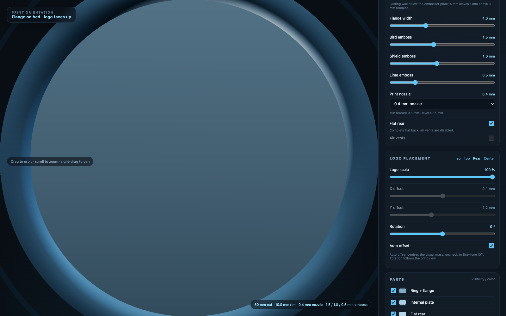

# Lakeland 60 mm Fondant Cutter / Embosser

A 60 mm round fondant cutter with a 3-level Lakeland emblem emboss, adjustable wall height, rim depth, and a complete flat rear. It also includes a local browser-based 3D editor for live parameter changes and STL/3MF downloads.



## Start here

There are two versions of the model:

| Version | Where | Rear | Logo position | Supports |
|---|---|---|---|---|
| **Flat rear** | **Editor → Downloads** (recommended) | Complete flat disc | Auto-offset to the visual centre | **No supports** |
| **Open rear** | Checked-in `lakeland_60mm_fondant_cutter_print.3mf` / `.stl` | Open cavity | Bounding-box centre | Tree supports under the internal plate |

The checked-in STL/3MF files are the **open-rear** version. For the current **flat-rear** and **auto-offset** version, use the editor's Downloads section.

## Run the 3D editor

```bash
cd "/Users/rayfoo/Desktop/Logo Cookie Cutter"
./run_editor.sh
```

The first run creates `.venv`, installs the Python dependencies, starts the local server, and opens **http://127.0.0.1:5050**.

- Set `NO_BROWSER=1 ./run_editor.sh` if you do not want it to open a browser automatically.
- Stop the server with `Ctrl+C` in the terminal that is running it.

## Editor controls

- **3D view:** orbit, zoom, and pan. **Iso**, **Top**, and **Rear** buttons give fixed views. Rear view hides the front parts so you can inspect the flat back; Top/Iso restore them.
- **Parts:** ring + flange, internal plate, flat rear, bird, shield, lime background, and the final print union. Toggle visibility, change colours, and use the exploded-view slider.
- **Cutter parameters:** cut diameter, wall thickness, wall height, rim depth, flange width, bird/shield/lime emboss depths.
- **Logo placement:** logo scale, auto offset, manual X/Y offset, rotation, **Center**, and the Top/Iso/Rear views.
- **Flat rear:** on by default. Produces a complete flat back and disables the air vents.
- **Print nozzle:** 0.2 / 0.4 / 0.6 / 0.8 mm. It changes the minimum feature cleanup, vent size, and recommended layer height.
- **Auto-update:** the 3D model refreshes after a short pause, or immediately with **Regenerate**. The camera view is preserved.
- **Downloads:** the latest STL and 3MF are always in the Downloads section at the top of the panel.

## Default dimensions

- **60.0 mm cut diameter**
- **71.6 mm overall diameter** at the press flange
- **18.0 mm wall height** by default
- **1.8 mm wall thickness**
- **10.0 mm rim depth** by default
- **1.5 mm bird emboss**, **1.0 mm shield emboss**, **0.5 mm lime background emboss**
- **3 mm fondant** design target
- Flat-rear default mesh volume: approximately **36,808 mm³**
- Open-rear checked-in mesh volume: approximately **19,844 mm³**
- Emblem clearance to the cutting ring: approximately **2.0 mm**

The logo is the **bird + shield emblem only**. The full “LAKELAND SENIOR HIGH SCHOOL” wording was omitted because it would be only about 1.7 mm tall at 60 mm and would not print cleanly with a 0.4 mm nozzle.

## Wall height, rim depth, and flat rear

- **Wall height** is the outer ring height. It can go down to **7 mm** with the flat rear when the rim depth is 4 mm. The open rear needs at least **18 mm**. The editor clamps the wall height to a safe minimum based on the rim depth and flat-rear mode.
- **Rim depth** is the cutting wall height below the embosser plate, adjustable from **4 to 12 mm**. At 4 mm the plate is just 1 mm above a 3 mm fondant sheet.
- **Flat rear** fills the back with a complete flat disc. Print it rear-down with **no supports**. The logo is on the **opposite (cutting) side**.
- **Open rear** is the original hollow-back version. It needs tree supports under the internal plate and can use the two air vents.

## Printing

See [PRINTING.md](PRINTING.md) for the full Bambu Studio settings, LAN workflow, post-processing, and troubleshooting.

Key points:

- Use **PETG** and dry it first.
- **Flat rear:** place the flat rear on the build plate; the logo faces up; **no supports**; first layer is a solid disc.
- **Open rear:** place the flange on the build plate; use tree supports **under the internal plate only**.
- The downloaded 3MF is **model-only**; slice it in Bambu Studio with the same nozzle selected in the editor.
- The logo is **not mirrored** on the fondant imprint.

## Files

| File | Purpose |
|---|---|
| `app.py` | Local Flask server for the 3D editor. |
| `run_editor.sh` | Creates `.venv`, installs dependencies, starts the editor. |
| `requirements.txt` | Python dependencies. |
| `web/` | Three.js frontend, CSS, and local vendor files. |
| `scripts/cutter_model.py` | Parametric model builder used by the editor. |
| `scripts/generate_cutter.py` | Original CLI generator for the checked-in open-rear files. |
| `source/Lakeland - Transparent (1).dxf` | Source logo artwork. |
| `lakeland_60mm_fondant_cutter_print.3mf` | Checked-in open-rear Bambu model. |
| `lakeland_60mm_fondant_cutter_print.stl` | Checked-in open-rear STL, print orientation. |
| `lakeland_60mm_fondant_cutter.stl` | Design/inspection orientation — **not** the print orientation. |
| `preview.png` | Model layout and cross-section preview. |
| `editor_preview.png` | Editor screenshot. |
| `PRINTING.md` | Detailed print guide. |

## Repository

<https://github.com/rayfoolshs/lakeland-60mm-fondant-cutter>

## Food safety

FDM-printed parts are not inherently food-safe. Layer lines can harbour bacteria, and filament colourants are not automatically food-safe.

- Use a food-safe barrier (cling film or acetate) or a certified food-safe coating on contact surfaces.
- Hand wash only; do not dishwasher.
- Do not use with hot food or leave in direct sunlight.
- For commercial or repeated food production, use a food-safe moulding process rather than bare FDM plastic.

## Logo artwork

The Lakeland Senior High School name and logo remain the property of Lakeland Senior High School. This repository contains the supplied source artwork and a 3D model generated from it for the school's cutter project.
